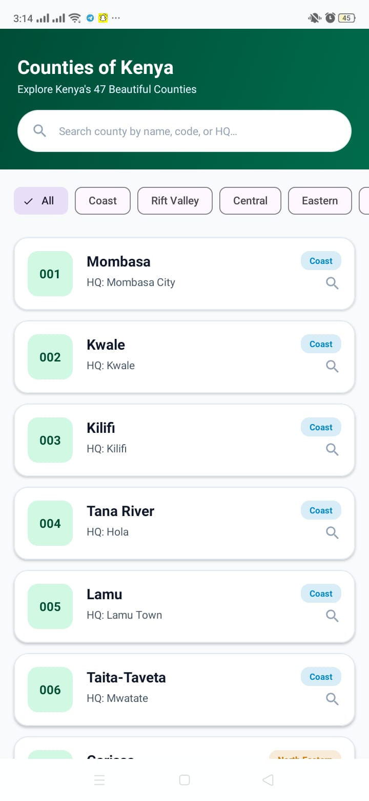
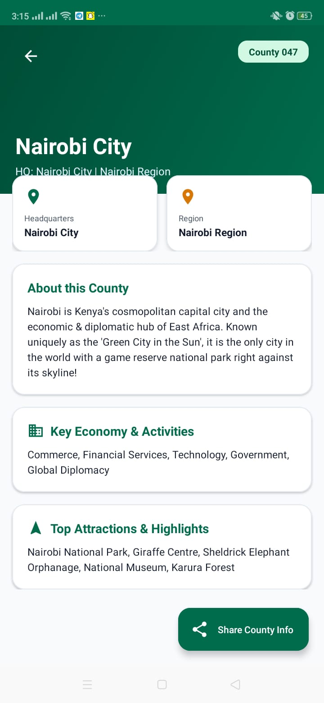
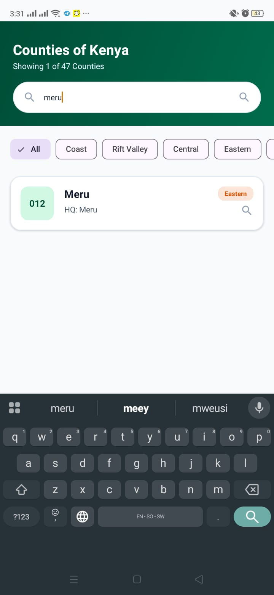

# 🇰🇪 Counties of Kenya

An Android mobile application developed using Java and Android Studio.

## About the Project

Counties of Kenya is an Android application project created as part of my ICT and mobile application development learning journey. This repository contains the source code and a downloadable APK for testing.

## Technologies Used

- Java
- Android Studio
- Gradle
- Git and GitHub

## Features

Features will be documented here based on the functionality implemented in the application.

## 📸 Screenshots

### Home Screen

### County Details

### Search Screen

## Download the App

Download the APK from the latest GitHub release:

**[Download Counties v1.0.0](https://github.com/LaurineOgutu-20/Counties/releases/latest)**

1. Open the release page on your Android phone.
2. Download `app-debug.apk`.
3. Open the downloaded file and follow Android's installation prompts.

*Note: This is a debug APK intended for testing.*

## How to Run the Project

1. Clone or download this repository.
2. Open the project in Android Studio.
3. Allow Gradle to sync.
4. Connect an Android phone or start an emulator.
5. Run the app from Android Studio.

## Developer

**Laurine Ogutu**

ICT Technician Student | Java | Android Development

## Project Status

Version: `v1.0.0`

This project is available for testing and further development.

## Repository

[View Counties on GitHub](https://github.com/LaurineOgutu-20/Counties)
